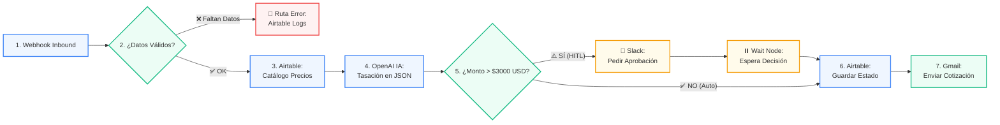

# 🏭 Ecosistema Autónomo de Cotizaciones Industriales con IA
### Flujo Integral con n8n, Airtable, OpenAI y Salida Multicanal (Gmail / Slack)

[](https://n8n.io/)
[](https://airtable.com/)
[-000000?style=for-the-badge&logo=ollama&logoColor=white)](https://ollama.ai/)
[](https://workspace.google.com/)
[](https://github.com/MiqueasSilva/IA-Automation-Final)

---

## 📌 1. Caso de Negocio: Empresa Sanmartín S.A.

**Empresa Sanmartín S.A.** es un fabricante de maquinaria industrial pesada para líneas de envasado, lavadoras de botellas industriales (serie *HydroClean*) y llenadoras isobáricas.

### El Proceso Automatizado
Este ecosistema atiende solicitudes técnicas y de cotización de clientes industriales de forma automática y segura:
1. **Recibe** la solicitud mediante Webhook o formulario.
2. **Valida** los datos de entrada (email con formato válido y mensaje técnico no vacío). Si faltan datos, desvía a la **Ruta de Error** en Airtable.
3. **Consulta** el catálogo de precios y repuestos de la maquinaria en **Airtable** (El Cerebro).
4. **Procesa y Tasa** la cotización con **OpenAI (GPT-4o-mini)** en formato JSON estructurado, calculando el costo total en USD y el Lead Score.
5. **Control Human-in-the-Loop (HITL):** Si el monto supera los **$3,000 USD**, el flujo se pausa en un nodo *Wait* y solicita aprobación en **Slack** antes de contactar al cliente, previniendo el "efecto metralleta".
6. **Entrega:** Actualiza el estado en Airtable y despacha la propuesta comercial formal vía **Gmail**.

---

## 🏛️ 2. Arquitectura del Flujo



---

## 🧰 3. Las 4 Tecnologías del Ecosistema

| Componente | Tecnología | Rol en la Solución |
| :--- | :--- | :--- |
| **1. Orquestador** | **n8n** | Motor de flujo central, control condicional, pausas asíncronas de aprobación (HITL) y captura de errores. |
| **2. Base de Datos** | **Airtable** | "El Cerebro": Memoria de cotizaciones, catálogo de maquinaria/repuestos y tabla de auditoría de errores. |
| **3. Procesamiento IA** | **Ollama (`qwen2.5:7b`) / OpenAI** | Tasación técnica de piezas, cálculo de costo total en USD, calificación de leads y salida estricta en JSON a costo cero y con privacidad local. |
| **4. Salida Multicanal** | **Gmail + Slack** | Envío de correo formal al cliente final y canal interactivo de validación humana en Slack. |

---

## 🧠 4. Estructura de la Base de Datos (Airtable)

El sistema utiliza 3 tablas conectadas:
1. **`Solicitudes_Cotizaciones` (Maestra):**
   - Campos: `ID_Solicitud`, `Nombre_Cliente`, `Email_Cliente`, `Equipo_Industrial`, `Monto_Total_USD`, `Estado` (*Pendiente, En Espera HITL, Aprobado por Humano, Auto-Aprobado*), `Resumen_IA`.
2. **`Catalogo_Maquinaria_Repuestos` (Catálogo):**
   - Base de piezas de repuesto y maquinarias de Sanmartín con costos de referencia en USD.
3. **`Logs_Auditoria_Errores` (Resiliencia):**
   - Registro de solicitudes incompletas o fallas de red para auditoría post-mortem.

> 📁 Los archivos CSV para importar directamente las tablas están disponibles en la carpeta [`/database`](database/).

---

## 🛑 5. Punto de Control Human-in-the-Loop (HITL)

Para evitar enviar ofertas automáticas desmedidas a clientes industriales:
- Si el presupuesto calculado por la IA es **mayor a $3,000 USD**, se activa el nodo **Wait (Webhook)** en n8n.
- Se envía un mensaje al canal de Slack `#aprobaciones-cotizaciones`.
- El flujo permanece en pausa reactiva hasta que el responsable comercial hace clic en el enlace de aprobación.
- Una vez aprobado, el flujo despierta y despacha el correo vía Gmail.

---

## 🧪 6. Matriz de Pruebas de Estrés

| Caso | Escenario | Entrada | Comportamiento | Estado en DB |
| :---: | :--- | :--- | :--- | :--- |
| **TEST-01** | **Camino Feliz Estándar** | Repuesto menor ($750 USD) | Monto &lt; 3000 USD. Salta HITL y envía correo directo. | `Auto-Aprobado` |
| **TEST-02** | **Camino Feliz con HITL** | Bomba de enjuague ($4,400 USD) | Supera $3,000 USD. Pausa en Slack. Se aprueba y envía correo. | `Aprobado por Humano` |
| **TEST-03** | **Camino Infeliz (Error)** | Email sin @ o mensaje vacío | Router de validación desvía a rama de error. **Aborta IA**. | `Error Validación` |

---

## 🔒 7. Checklist de Seguridad

- [x] **Filtro anti-bucles:** El trigger solo procesa solicitudes entrantes y cambia el estado de inmediato.
- [x] **Tipos de datos estrictos:** Casting numérico explícito (`Number(monto) > 3000`) para las evaluaciones lógicas.
- [x] **Prompts dinámicos:** La IA recibe las variables del cliente y el catálogo inyectados en tiempo de ejecución.
- [x] **Sin datos hardcodeados:** Todas las rutas consumen variables del contexto de n8n.

---

## 📂 8. Estructura de Entregables del Repositorio

```text
IA Automation/
├── README.md                                          <- Documentación técnica del ecosistema
├── Entrega_Final_Ecosistema_IA_Sanmartin.pdf         <- Documento PDF oficial de entrega (arquitectura y diagramas)
├── workflows/
│   ├── ecosistema_ia_sanmartin.n8n.json              <- Flujo principal de n8n (listo para importar)
│   └── ecosistema_ia_sanmartin.make_blueprint.json   <- Blueprint alternativo para Make
├── database/
│   ├── airtable_schema_sanmartin.md                  <- Especificación del Cerebro y Relaciones
│   ├── Solicitudes_Cotizaciones_Template.csv         <- Template para la tabla maestra
│   ├── Catalogo_Maquinaria_Template.csv              <- Catálogo de repuestos y equipos
│   └── Logs_Auditoria_Errores_Template.csv           <- Registro de auditoría de errores
├── tests/
│   ├── stress_test_matrix.md                         <- Documentación de las pruebas de estrés
│   └── mock_test_payloads.json                       <- Payloads JSON listos para pruebas
├── docs/
│   └── checklist_seguridad_arquitectura.md           <- Checklist de seguridad y resiliencia
└── assets/
    └── diagramas/
        └── arquitectura_ecosistema_sanmartin.svg     <- Diagrama vectorial de la arquitectura
```

---

## 🎥 9. Video Demostrativo

Demostración en video del flujo en funcionamiento en vivo (Trigger, procesamiento con IA, bifurcación HITL en Slack y envío de cotización):

> 📹 **Video Demo:** [Ver Video en Loom / Drive](https://drive.google.com/your-video-link-here)

---

*Proyecto desarrollado para la Diplomatura de IA Automation por Miqueas Silva — Coderhouse (Noviembre 2026).*
