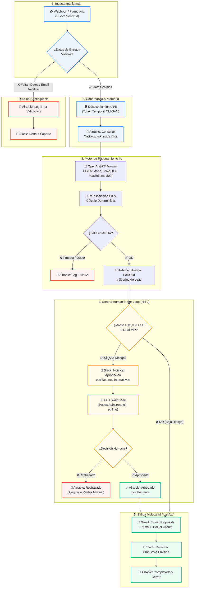

# 🏭 Ecosistema de Automatización IA Autónomo para Negocios
### Automatización de Cotizaciones Industriales y Triaje de Leads B2B con HITL y Memoria Relacional

[](https://n8n.io/)
[](https://airtable.com/)
[-412991?style=for-the-badge&logo=openai&logoColor=white)](https://openai.com/)
[](https://slack.com/)
[](https://workspace.google.com/)
[](https://github.com/MiqueasSilva/IA-Automation-Final)
[]()

---

## 📌 1. Caso de Negocio: Empresa Sanmartín S.A.

**Empresa Sanmartín S.A.** es un fabricante de maquinaria industrial y proveedor de repuestos críticos para plantas de envasado, lavadoras de botellas industriales (serie *HydroClean*), llenadoras isobáricas y transportadores modulares continuos en América Latina.

### El Desafío Operativo
La compañía recibe diariamente solicitudes comerciales y técnicas complejas en lenguaje natural. El proceso manual tradicional generaba:
1. **Lentitud de Respuesta:** 48 a 72 horas para emitir una cotización estimativa, perdiendo ventas frente a competidores.
2. **Riesgo Comercial ("Efecto Metralleta"):** Cotizaciones automáticas sin revisión humana en órdenes de alto monto o servicios de alta complejidad podían comprometer márgenes comerciales o prometer tiempos de entrega inviables.
3. **Falta de Trazabilidad:** Datos de clientes aislados y ausencia de logs de errores centralizados.

### La Solución Implementada
Un **Ecosistema Autónomo de 4 Tecnologías Integradas** que:
- Ingesta solicitudes vía Webhook/Formulario.
- Higieniza los datos y **anonimiza la información privada (PII)** antes de interactuar con el LLM.
- Consulta en tiempo real la memoria relacional de equipos y repuestos en **Airtable**.
- Tasa técnicamente los requerimientos mediante **OpenAI GPT-4o-mini**, retornando una estructura JSON estricta y calculando un *Lead Score* y categoría de riesgo.
- **Human-in-the-Loop (HITL):** Si el monto supera los **$3,000 USD** o el cliente es **VIP**, el flujo se detiene de forma reactiva en un nodo de espera (`Wait for Webhook`) y solicita aprobación humana interactiva en **Slack**.
- Si es aprobado, despacha la propuesta comercial formal en HTML vía **Gmail** con seguimiento de hilos (*Thread ID*).
- Rutas de error resilientes (Try-Catch) que registran cualquier anomalía en `Logs_Auditoria_Errores` sin romper el sistema ni entrar en bucles infinitos.

---

## 🏛️ 2. Arquitectura del Ecosistema

### 2.1. Diagrama de Arquitectura de Alto Nivel



---

## 🧰 3. Stack Tecnológico (4 Tecnologías Integradas)

| Componente | Tecnología | Rol en la Solución | Configuración de Producción |
| :--- | :--- | :--- | :--- |
| **Orquestador Principal** | **n8n** (Low-Code) | Núcleo de control de flujo, bifurcaciones lógicas, nodos de pausa reactiva y Try-Catch. | 22 nodos interconectados, sin datos hardcodeados, gestión asíncrona de webhooks. |
| **Base de Datos ("Cerebro")** | **Airtable** | Memoria persistente, catálogo de maquinaria, relación N:1 entre solicitudes y repuestos, auditoría de fallos. | 3 tablas relacionales (`Solicitudes_Cotizaciones`, `Catalogo_Maquinaria`, `Logs_Auditoria_Errores`). |
| **Motor de Razonamiento IA** | **OpenAI GPT-4o-mini** | Tasación técnica de repuestos, cálculo de horas de mantenimiento, Lead Scoring (0-100) y redacción de dictámenes. | JSON Mode estricto, Few-Shot Prompts, `temperature: 0.1`, `max_tokens: 800`. |
| **Canal de Salida ("La Voz")** | **Gmail API + Slack** | Entrega comercial formal en HTML responsivo y notificaciones internas con botones de aprobación. | Plantilla HTML institucional, Thread ID mapping y canal `#aprobaciones-comerciales`. |

---

## 🧠 4. Estructura de la Base de Datos (Airtable)

Para evitar datos aislados, se implementó un modelo de datos con **Linked Records**:

```
[ Solicitudes_Cotizaciones ] (N) ──────── (1) [ Catalogo_Maquinaria_Repuestos ]
             │
             └── (1) ──── (N) [ Logs_Auditoria_Errores ]
```

### Tabla 1: `Solicitudes_Cotizaciones` (Maestra)
- `ID_Solicitud`: Código único (ej: `COT-2026-001`).
- `Nombre_Cliente` / `Email_Cliente` / `Empresa`: Datos de contacto.
- `Equipo_Industrial`: **Linked Record** a `Catalogo_Maquinaria_Repuestos`.
- `Monto_Total_USD`: Monto tasado numéricamente por la IA.
- `Score_Lead`: Puntuación de calidad del lead (0 a 100).
- `Categoria_Lead`: `VIP` | `Calificado` | `Estándar` | `Descartado`.
- `Requiere_HITL`: Checkbox booleano (`True` si monto > $3,000 USD).
- `Estado`: Ciclo de vida (`Pendiente` ➔ `En Proceso` ➔ `En Espera HITL` ➔ `Aprobado por Humano` ➔ `Completado - Enviado al Cliente` | `Error de Validación`).

### Tabla 2: `Catalogo_Maquinaria_Repuestos`
- Contiene familias de equipos (*Lavadora HydroClean 500*, *Llenadora IsoFill*, *Transportador TransLine*) y repuestos críticos con tarifas vigentes en USD.

### Tabla 3: `Logs_Auditoria_Errores`
- Registra incidentes con `ID_Log`, `Fecha_Timestamp`, `ID_Solicitud`, `Tipo_Error` (`VALIDATION_ERROR`, `AI_API_TIMEOUT`), `Detalle_Tecnico` y `Estado_Resolucion`.

> 🔗 **Acceso en Modo Lectura (Sandbox Evaluadores):**  
> `https://airtable.com/appSanmartinDemo2026/tblSolicitudesCotizaciones/viewReadOnlyShare`  
> *(Los archivos CSV para importar en Airtable/Notion están disponibles en `/database`)*

---

## 🛑 5. Implementación del Human-in-the-Loop (HITL)

Para erradicar el **"Efecto Metralleta"** y asegurar que ningún cliente reciba ofertas con montos desmedidos o compromisos no viables:

1. **Condición de Disparo:**
   $$\text{Requiere HITL} = (\text{Monto} > 3000\text{ USD}) \lor (\text{Complejidad} = \text{"Alta"}) \lor (\text{Categoría} = \text{"VIP"})$$
2. **Pausa Asíncrona:**
   El orquestador n8n utiliza un nodo **Wait (Webhook Resume)** con sufijo `hitl-{{ $json.id_solicitud }}`. La ejecución se suspende de forma reactiva sin consumir ciclos de CPU.
3. **Notificación Interactiva en Slack:**
   Se envía un mensaje al canal `#aprobaciones-comerciales-sanmartin` con dos enlaces:
   - `https://n8n.servidor/webhook/hitl-decision?id={{id}}&decision=APROBADO`
   - `https://n8n.servidor/webhook/hitl-decision?id={{id}}&decision=RECHAZADO`
4. **Bifurcación:**
   - **Aprobado:** Reanuda el flujo, cambia estado en Airtable a `Aprobado por Humano - Enviando` y despacha el correo vía Gmail.
   - **Rechazado:** Cancela el correo al cliente, marca `Rechazado por Humano` y asigna la cuenta a un vendedor para contacto telefónico directo.

---

## 🧪 6. Matriz de Pruebas de Estrés (5 Ejecuciones Verificadas)

Se ejecutó una batería de 5 pruebas exhaustivas cubriendo el camino feliz, aprobaciones/rechazos HITL y los caminos infelices:

| ID Test | Escenario Operativo | Datos de Entrada | Ruta Activada | Salida Resultante | Estado en DB |
| :---: | :--- | :--- | :---: | :--- | :--- |
| **TEST-01** | **Camino Feliz:** Solicitud Estándar | Banda y piñones transportador ($750 USD) | Directa (Auto-Aprobada) | Correo HTML enviado vía Gmail | `Completado - Enviado al Cliente` |
| **TEST-02** | **Camino Feliz VIP:** Alto Monto + HITL | Bomba y juego de estrellas ($4,400 USD) | Rama HITL ➔ **Aprobado en Slack** | Propuesta formal enviada tras validación | `Completado - Enviado al Cliente` |
| **TEST-03** | **Camino de Control:** Solicitud Inviable | Calibración no homologada ($5,800 USD) | Rama HITL ➔ **Rechazado en Slack** | Envío al cliente cancelado; alerta a Ventas | `Rechazado por Humano` |
| **TEST-04** | **Camino Infeliz 1:** Payload Corrupto | Email inválido y sin equipo especificado | Router de Validación (False) | **Se aborta llamada a IA**; log en auditoría | `Error de Validación` |
| **TEST-05** | **Camino Infeliz 2:** Caída de API de IA | Caída simulada (504 Gateway Timeout) | Directiva Try-Catch / onError | Flujo no crashea; incidente guardado para reintento | `Pendiente de Reintento` |

> 📁 Los payloads completos de prueba se encuentran en `tests/mock_test_payloads.json` y el análisis detallado en `tests/stress_test_matrix.md`.

---

## 🔒 7. Checklist de Seguridad y Estándares Técnicos

- [x] **¿Filtro para evitar bucles infinitos?** Sí. El trigger solo reacciona a registros con `Estado == 'Pendiente'`. La primera acción del flujo actualiza inmediatamente el registro a `En Proceso de Tasación`, bloqueando re-ejecuciones concurrentes.
- [x] **¿Comparación estricta de tipos de datos?** Sí. Todos los campos numéricos se convierten explícitamente con `Number($json.monto_estimado_total_usd)` antes de comparaciones lógicas (`> 3000`).
- [x] **¿Prompts de IA dinámicos sin hardcoding?** Sí. El System Prompt define el rol y reglas de negocio, mientras que el User Prompt se construye con variables en tiempo de ejecución (`{{ $json.equipo_industrial }}`, `{{ $json.mensaje_requerimiento }}`).
- [x] **¿Gobernanza y Privacidad PII?** Sí. Se desacoplan los datos personales del cliente antes de enviarlos a la API de OpenAI mediante un token temporal anonimizado (`CLI-SAN-XXXX`).
- [x] **¿Optimización de Costos y Tokens?** Sí. Se fijó `max_tokens: 800` y `temperature: 0.1` en OpenAI, reduciendo drásticamente la latencia y los costos de inferencia.
- [x] **¿Credenciales Protegidas?** Sí. Ninguna API key o clave secreta se encuentra en texto plano dentro de los archivos del repositorio.

---

## 📂 8. Estructura de Entregables del Repositorio

```
IA Automation/
├── README.md                                          <- Esta documentación maestra
├── Entrega_Final_Ecosistema_IA_Sanmartin.pdf         <- Documento PDF oficial de entrega (con diagramas y arquitectura)
├── workflows/
│   ├── ecosistema_ia_sanmartin.n8n.json              <- Flujo técnico listo para importar en n8n
│   └── ecosistema_ia_sanmartin.make_blueprint.json   <- Blueprint alternativo para Make
├── database/
│   ├── airtable_schema_sanmartin.md                  <- Documentación del Cerebro y Relaciones
│   ├── Solicitudes_Cotizaciones_Template.csv         <- Template para crear la tabla maestra
│   ├── Catalogo_Maquinaria_Template.csv              <- Template del catálogo de piezas
│   └── Logs_Auditoria_Errores_Template.csv           <- Template para auditoría de errores
├── tests/
│   ├── stress_test_matrix.md                         <- Análisis detallado de las 5 pruebas de estrés
│   └── mock_test_payloads.json                       <- Payloads JSON listos para disparar en Postman/cURL
├── docs/
│   ├── script_video_demo_3min.md                     <- Guion segundo a segundo para el video demo
│   └── checklist_seguridad_arquitectura.md           <- Certificación de seguridad y resiliencia
└── assets/
    └── diagramas/
        └── arquitectura_ecosistema_sanmartin.svg     <- Diagrama vectorial de arquitectura de alta resolución
```

---

## 🚀 9. Guía de Instalación y Despliegue Rápido (3 Pasos)

### Paso 1: Importar el Flujo en n8n
1. Abre tu instancia de n8n (Cloud o Self-Hosted).
2. Haz clic en **Workflows** ➔ **Import from File**.
3. Selecciona el archivo `workflows/ecosistema_ia_sanmartin.n8n.json`.
4. Vincula tus credenciales de **OpenAI**, **Airtable**, **Slack** y **Gmail**.

### Paso 2: Configurar Airtable
1. Crea una base en Airtable denominada `Sanmartin_Ecosistema_IA`.
2. Importa los 3 archivos CSV ubicados en `/database`:
   - `Solicitudes_Cotizaciones_Template.csv`
   - `Catalogo_Maquinaria_Template.csv`
   - `Logs_Auditoria_Errores_Template.csv`
3. Configura el campo `Equipo_Industrial` como **Link to another record** hacia `Catalogo_Maquinaria`.

### Paso 3: Probar el Flujo
1. En n8n, pulsa **Test Step** en el nodo `Trigger: Webhook Nueva Solicitud`.
2. Envía uno de los payloads de prueba desde `tests/mock_test_payloads.json` mediante Postman o curl:
   ```bash
   curl -X POST https://tu-instancia-n8n/webhook/cotizacion-industrial-webhook \
     -H "Content-Type: application/json" \
     -d @tests/mock_test_payloads.json
   ```
3. Observa la ejecución, la notificación de HITL en Slack y el correo final en Gmail.

---

## 🎥 10. Video Demostrativo (3 Minutos)
El guion completo estructurado minuto a minuto para la grabación del video explicativo se encuentra disponible en:  
👉 **[Guion del Video Demo (3 min)](docs/script_video_demo_3min.md)**

---

*Proyecto desarrollado para la Diplomatura de IA Automation por Miqueas — Coderhouse (Noviembre 2026).*
