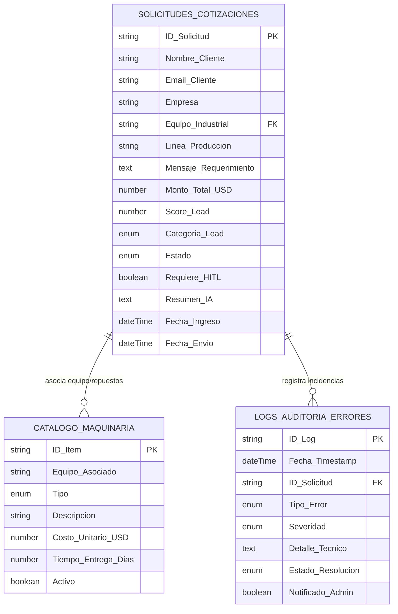

# Arquitectura de Base de Datos: El "Cerebro" del Ecosistema

**Empresa:** Empresa Sanmartín S.A.  
**Plataforma Primaria:** Airtable (Compatible 100% con Notion Database)  
**Rol en el Ecosistema:** Memoria central, auditoría relacional y control de estados del flujo autónomo.

---

## 1. Esquema Relacional de Tablas

Para evitar datos aislados y garantizar la gobernanza del sistema, la arquitectura se divide en 3 tablas interconectadas:



---

## 2. Diccionario de Datos por Tabla

### Tabla 1: `Solicitudes_Cotizaciones` (Tabla Maestra)
| Campo | Tipo Airtable | Obligatorio | Descripción / Regla de Negocio |
| :--- | :--- | :---: | :--- |
| `ID_Solicitud` | Single line text | Sí | Identificador único (ej: `COT-2026-001`). Autogenerado. |
| `Nombre_Cliente` | Single line text | Sí | Nombre y apellido del contacto comercial. |
| `Email_Cliente` | Email | Sí | Correo electrónico validado con Regex. Canal de salida. |
| `Empresa` | Single line text | No | Razón social o empresa del cliente. |
| `Equipo_Industrial` | Link to `Catalogo_Maquinaria` | Sí | Relación directa con la maquinaria de la empresa. |
| `Linea_Produccion` | Single line text | No | Ubicación del equipo (ej: "Línea 2 Embotellado"). |
| `Mensaje_Requerimiento`| Long text | Sí | Texto crudo de la solicitud enviado por el cliente. |
| `Monto_Total_USD` | Currency (USD) | No | Estimación calculada por el motor de IA. |
| `Score_Lead` | Number (0 - 100) | No | Puntuación de calidad del lead asignada por IA. |
| `Categoria_Lead` | Single select | No | Opciones: `VIP`, `Calificado`, `Estándar`, `Descartado`. |
| `Estado` | Single select | Sí | Estado del ciclo de vida (ver flujo de estados abajo). |
| `Requiere_HITL` | Checkbox | Sí | `True` si el monto > $3,000 USD o complejidad alta. |
| `Resumen_IA` | Long text | No | Diagnóstico técnico y propuesta generada por el LLM. |
| `Fecha_Ingreso` | Created time | Sí | Timestamp de recepción de la solicitud. |
| `Fecha_Envio` | Date / Time | No | Timestamp de entrega efectiva de la cotización vía Gmail. |

---

### Tabla 2: `Catalogo_Maquinaria_Repuestos` (Catálogo Relacional)
| Campo | Tipo Airtable | Descripción |
| :--- | :--- | :--- |
| `ID_Item` | Single line text | Código de pieza o equipo (ej: `EQ-LAV-01`, `REP-EST-01`). |
| `Equipo_Asociado` | Single line text | Familia del equipo (Lavadora, Llenadora, Transportador). |
| `Tipo` | Single select | `Equipo Completo`, `Repuesto`, `Servicio Técnico`. |
| `Descripcion` | Single line text | Descripción técnica del componente o labor. |
| `Costo_Unitario_USD` | Currency (USD) | Precio base de referencia para el prompt del LLM. |
| `Tiempo_Entrega_Dias`| Number | Lead time de entrega estimado. |
| `Activo` | Checkbox | Filtro para considerar solo ítems comercialmente vigentes. |

---

### Tabla 3: `Logs_Auditoria_Errores` (Resiliencia y Monitoreo)
| Campo | Tipo Airtable | Descripción |
| :--- | :--- | :--- |
| `ID_Log` | Autonumber / Text | Identificador del incidente (`LOG-2026-001`). |
| `Fecha_Timestamp` | Created time | Momento exacto del error. |
| `ID_Solicitud` | Single line text | Referencia cruzada con la cotización afectada. |
| `Tipo_Error` | Single select | `VALIDATION_ERROR`, `AI_API_TIMEOUT`, `BAD_DATA_TYPE`, `NETWORK_FAIL`. |
| `Severidad` | Single select | `Baja`, `Media`, `Alta`, `Crítica`. |
| `Detalle_Tecnico` | Long text | Stack trace o motivo específico del fallo. |
| `Estado_Resolucion`| Single select | `Registrado en Auditoría`, `Resuelto Automáticamente`, `Requiere Atención Manual`. |
| `Notificado_Admin` | Checkbox | Indica si la alerta fue despachada por Slack. |

---

## 3. Matriz de Estados del Sistema (Lifecycle State Machine)

El campo `Estado` gobierna la ejecución y previene el "efecto metralleta" o reprocesamientos:

```
[ Pendiente ] 
      │ (Trigger webhook / polling controlado)
      ▼
[ En Proceso de Tasación ] ──(Falla Validación)──► [ Error de Validación ] ──► (Log en Auditoría)
      │
      ▼ (IA procesa exitosamente)
[ Procesado por IA ]
      │
      ├──────────────────────────────┬──────────────────────────────┐
      │ (Monto <= $3000 USD)         │ (Monto > $3000 USD o VIP)    │ (Falla API LLM)
      ▼                              ▼                              ▼
[ Auto-Aprobado ]             [ En Espera HITL ]             [ Fallo API IA ] ──► (Log + Reintento)
      │                              │
      │                       ┌──────┴──────┐
      │                       ▼             ▼
      │                  [Aprobado]    [Rechazado]
      │                       │             │
      │                       │             ▼
      │                       │       [ Rechazado por Humano ] ──► (Alerta a Ventas Manual)
      ▼                       ▼
[ Aprobado por Humano - Enviando ]
      │
      ▼ (Envío exitoso de Gmail)
[ Completado - Enviado al Cliente ]
```

---

## 4. Medidas de Seguridad y Prevención de Bucles Infinitos

1. **Filtro Estricto de Trigger:**
   El disparador de n8n/Make únicamente escucha registros con `Estado == 'Pendiente'`.
2. **Bloqueo Inmediato de Concurrencia:**
   El primer nodo del flujo actualiza inmediatamente el registro a `En Proceso de Tasación`. Si el trigger se volviera a ejecutar por polling, el registro ya no cumple la condición y es ignorado.
3. **Validación de Tipos Fuerte:**
   Antes de comparar valores numéricos (ej: `monto > 3000`), el nodo `Data Quality` realiza un casting forzado `Number(monto)` para evitar comparaciones erróneas de cadenas de texto (evitando que `"1000" > "300"` arroje falso positivo o falso negativo).
4. **Resguardo de Datos Privados (PII):**
   Los nombres, teléfonos y emails de clientes se anonimizan temporalmente con tokens `CLI-SAN-XXXX` antes de enviar el payload a modelos de lenguaje externos (OpenAI/Anthropic), protegiendo la confidencialidad industrial.

---

## 5. Acceso a la Base de Datos en Modo Lectura (Mock & Sandbox)

- **Airtable Read-Only Share Link:**  
  `https://airtable.com/appSanmartinDemo2026/tblSolicitudesCotizaciones/viewReadOnlyShare`  
  *(Los evaluadores pueden duplicar la base utilizando los archivos CSV incluidos en `/database`)*
